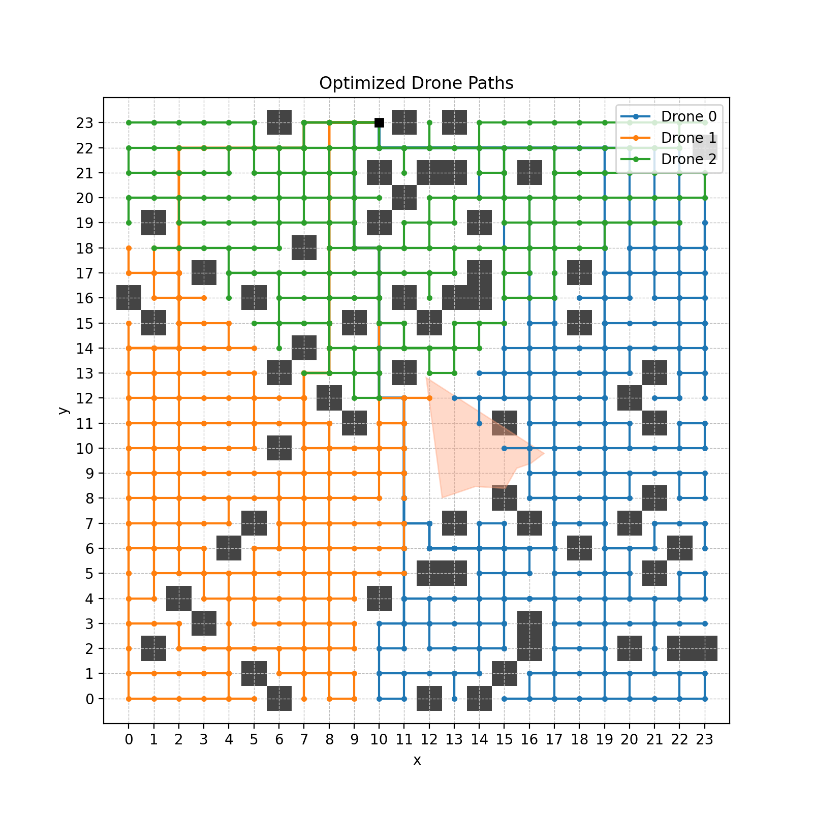

# Multi-drone Area Coverage Optimizer

_End-to-end toolkit for planning, scheduling and simulating cooperative drone coverage missions over cluttered 2D workspaces._



## Problem Statement

Given a `W x H` grid with blocked cells (obstacles), polygonal no-fly zones and one or more depots, plan tours for up to `max_drones` identical drones so that **every free cell a depot can reach is visited**. Drones move on the 4-connected grid at speed `v`, pay one time unit per heading change, carry a battery of `B` time units per sortie and must take off from and land at a depot (costing `takeoff_cost` / `landing_cost`). The pipeline minimises makespan while keeping the fleet as small as that allows, and can alternatively minimise the fleet under a makespan deadline.

## Pipeline

```
generate ──► partition ──► plan ──► optimize ──► simulate ──► visualize
 (python)    (haskell)    (haskell)   (python)     (python)     (python)
 map.json    regions.json tours_initial.json  tours_optimized.json  metrics.json  path.png
```

| Stage | Where | What it does |
| --- | --- | --- |
| generate | `python/src/fleet/generate_map.py` | Random obstacles, star-shaped no-fly polygons, depots on free cells; writes `map.json` + `params.json`. |
| partition | `haskell/src/Partition/` | Splits the cells **reachable from the depots** into one connected region per drone. `region` (default) grows regions from depot/far seeds with cost balancing; `strip` cuts vertical strips; `auto` plans both and keeps the better optimized schedule. |
| plan | `haskell/src/Coverage/` | Builds a coverage route per region (`stc`: 2×2 mega-cell spanning-tree cover, `boustro`: lawnmower sweep, `auto`: mega-STC / fine-STC / boustro, keeping the faster -- the default) then short-cuts useless revisit loops. `Coverage.Repair` turns the route into a timed tour with battery-aware recharges. |
| optimize | `python/src/fleet/optimize.py` | CP-SAT model assigning tours to physical drones (a drone may fly several tours back to back after recharging), never mixing depots. Objective: `makespan + drone_cost · drones`, or drones-first under `--deadline`. |
| simulate | `python/src/fleet/simulate.py` | Replays the tours and checks continuity, obstacle avoidance, per-sortie battery budget and coverage of every reachable cell. Unreachable pockets are reported, not counted as gaps. |
| visualize | `python/src/fleet/visualize.py` | PNG of the workspace and tours, optional MP4 (needs ffmpeg). |

JSON contracts between the stages live in `schema/` and are validated by the Python test suite.

## Quick Start

Requirements: [`stack`](https://docs.haskellstack.org) (GHC 9.6 via LTS 22) and [`uv`](https://docs.astral.sh/uv/).

```bash
make setup                       # install toolchains and dependencies
make build                       # builds haskell/bin/coverage-{partitioner,planner}
make run SEED=1337               # full pipeline, outputs in outputs/1337/
make run SEED=7 ARGS="--width 60 --height 60 --depots 2 --battery 400 --coverage-algorithm boustro"
make test                        # QuickCheck properties + pytest (incl. end-to-end runs)
```

### Plan a real site (website + CLI)

```bash
make serve                       # http://127.0.0.1:8000 — disclaimer gate, then planner
make site                        # examples/sites/solar_farm.geojson → outputs/site-solar/
# California crop fields: examples/sites/dwr/2023/<county>/<crop>/<field>.geojson
# USDA sample: examples/sites/csb/2024/<state>/<crop>/<field>.geojson
# Orchard crops follow the long axis; row crops keep the east-west auto sweep.
# Refresh the map-service states (MN, IA, ND, SD):
#   python3 tools/fetch_dwr_fields.py
#   python3 tools/fetch_csb_fields.py
# More states (AR, GA, IL, KS, NE, TX) from a local cache of the national gdb,
# which is not committed:
#   python3 tools/fetch_csb_fields.py --national
```

The public site is **donation-funded** (no subscriptions). Authors **accept no
responsibility** for flights or damage — see [LEGAL.md](LEGAL.md) and
[docs/PRODUCT.md](docs/PRODUCT.md).

Every stage is also available on its own:

```bash
cd python
uv run python -m fleet generate --seed 42 --width 50 --height 50 --obstacle-density 0.2
uv run python -m fleet plan     --map ../outputs/42/map.json --params ../outputs/42/params.json \
                                --output ../outputs/42/tours_initial.json --algorithm stc --partition region
uv run python -m fleet optimize --input ../outputs/42/tours_initial.json --output ../outputs/42/tours_optimized.json \
                                --max-drones 5 --deadline 2000
uv run python -m fleet simulate --map ../outputs/42/map.json --params ../outputs/42/params.json \
                                --tours ../outputs/42/tours_optimized.json --metrics ../outputs/42/metrics.json
uv run python -m fleet visualize --map ../outputs/42/map.json --tours ../outputs/42/tours_optimized.json --png ../outputs/42/path.png
```

`simulate` (and `run`) exit non-zero when the plan violates a check; the details are in `metrics.json` under `checks.problems`.

Set `FLEET_ROOT`, `FLEET_OUTPUTS` or `FLEET_HASKELL_BIN` to relocate the repository root, the output directory or the Haskell binaries.

## Measuring plan quality

`make bench` runs a fixed matrix of missions and reports what the plans cost:

```bash
make bench                                  # print the table
make bench ARGS="--compare benchmarks/baseline.json"   # diff against the baseline
```

The columns that matter are `length` (total flown steps), `commute` (the share
of those steps spent travelling between a depot and the area being covered) and
`steps/cell`. `benchmarks/baseline.md` holds the current numbers, and
`docs/ROADMAP.md` argues from them. `metrics.json` carries the same breakdown
per mission under `efficiency`.

Golden tests in `python/tests/test_regression.py` pin the planner's output, so
a change in plan quality shows up as a failing test rather than a silent
regression; refresh them with `FLEET_UPDATE_GOLDEN=1 uv run pytest`.

## Scale

Measured on a laptop, single depot, `--obstacle-density 0.01 --battery 5000`:

| Grid | Reachable cells | Partition | Plan | Optimize | Simulate | Peak RSS |
| --- | --- | --- | --- | --- | --- | --- |
| 100 x 100 | ~8k | < 1 s | < 1 s | ~2 s | < 1 s | small |
| 1000 x 1000 | ~990k | 8 s | 50 s | 11 s | 10 s | ~2.5 GB |

Planning is dominated by building the cheapest-return field for each depot;
the field is now a flat unboxed array (`DepotField`), regions plan in parallel,
and site missions also write compact `runs-v1` tours.

## Troubleshooting

**`cannot find 'ld'` / `Couldn't figure out linker information` when building
Haskell.** GHC ships configured for `ld.gold`, which recent binutils (2.44+)
no longer provide. Point it at `ld.bfd` instead:

```bash
SETTINGS=~/.stack/programs/x86_64-linux/ghc-tinfo6-*/lib/ghc-*/lib/settings
sed -i 's/-fuse-ld=gold/-fuse-ld=bfd/; s/"ld\.gold"/"ld.bfd"/g' $SETTINGS
```

**`Haskell binaries not found`.** Run `make build`, or set `FLEET_HASKELL_BIN`
to the directory holding `coverage-partitioner` and `coverage-planner`.

## Design Notes

- **Reachability first.** Partitioning, planning and the coverage metric all work on the set of free cells reachable from a depot. Pockets sealed off by obstacles or no-fly zones are neither assigned nor counted.
- **Battery invariant.** While airborne the drone always holds `battery_used + return_cost(current) ≤ B`, where `return_cost` follows the depot's BFS tree (distance, turns and landing included). A move that would break the invariant triggers a recharge first. Cells whose round trip exceeds `B` are reported on stderr and skipped rather than failing the mission.
- **Pattern choice is per region, not per mission.** The lawnmower sweep is
  cheaper on open ground and the spanning-tree walk on cluttered ground, and a
  single map usually contains both. Planning each region twice and keeping the
  faster tour costs a little planning time and is worth about 14% of the
  flight.
- **Makespan vs fleet size.** Executing all tours on one drone is always feasible, so "minimise drones" alone is degenerate. The optimizer therefore minimises makespan and uses `--drone-cost` (seconds of makespan one extra drone is worth, default 1) to prefer smaller fleets on ties; `--deadline` flips the priority.
- **Path length** is fixed once tours are planned (rearranging tours between drones does not change it), so it is reported but not optimised.

## Repository Layout

- `haskell/` – pure core: domain model, A*/BFS, partitioners, coverage planners, battery-aware tour builder, CLI executables.
- `python/` – map generator, CP-SAT optimizer, simulator, visualizer and the `fleet` CLI.
- `schema/` – JSON schemas for every artefact exchanged between stages.
- `docs/` – algorithm overview and figures.
- `tools/` – benchmark harness and LOC reporting.
- `benchmarks/` – stored benchmark baselines.
- `.github/workflows/` – Haskell, Python and end-to-end pipeline CI.

See [docs/overview.md](docs/overview.md) for the algorithms, [docs/ROADMAP.md](docs/ROADMAP.md) for what is planned next, [docs/PRODUCT.md](docs/PRODUCT.md) for the commercial product slice, and [CONTRIBUTING.md](CONTRIBUTING.md) for the development workflow.
