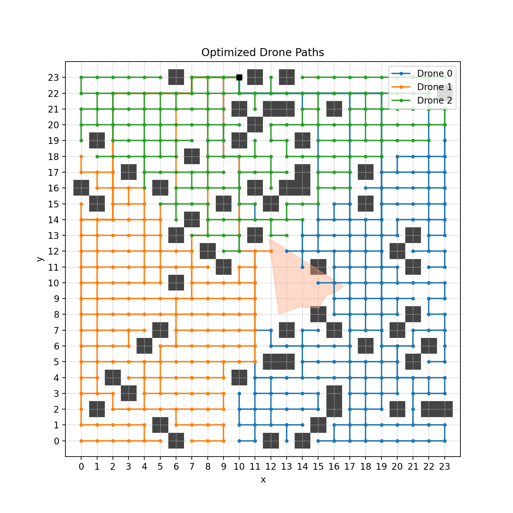
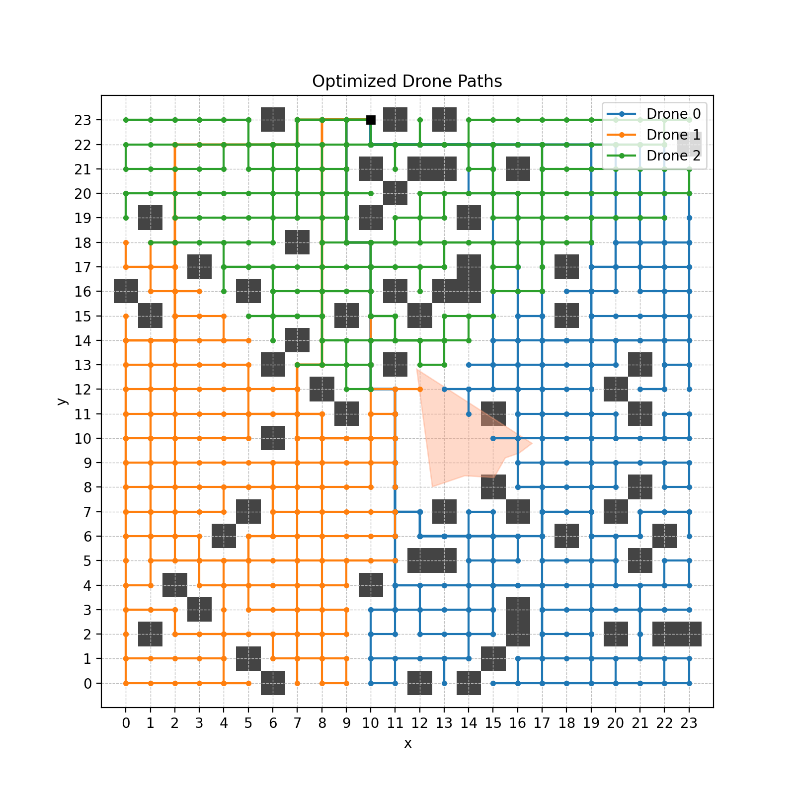

# Algorithms Overview

## Partitioning (`haskell/src/Partition/`)

Both partitioners first compute the free cells reachable from the depots with a breadth-first flood fill (`Domain.Map.reachableFree`); everything else is ignored.

- **Region growing** (`--method region`, default). Seeds are the depots plus farthest-point samples of the reachable set. Regions then grow by always letting the region with the lowest accumulated round-trip commute cost claim the next frontier cell. Distant cells weigh more than nearby ones, so makespan stays fairer than equal cell counts, and every region stays connected by construction.
- **Strips** (`--method strip`). Vertical strips of equal width. Simple and predictable, but strips may be disconnected by obstacles; the planner bridges the gaps.

## Coverage patterns (`haskell/src/Coverage/`)

| STC | Boustrophedon |
| --- | --- |
|  |  |

- **STC** (`--coverage-algorithm stc`) walks a depth-first spanning tree of the region and traverses every edge twice, so the walk ends where it started. Every connected component of the region gets its own walk.
- **Boustrophedon** (`--coverage-algorithm boustro`) sweeps rows in alternating directions and joins non-adjacent consecutive cells with a BFS shortest path inside the region. It produces fewer turns and shorter routes on open areas.
- **Auto** (`--coverage-algorithm auto`, the default) plans each region with both patterns and keeps the faster tour. Which pattern wins depends on how cluttered the region is, and that varies between regions of the same map, so the choice is made per region rather than per mission.

## Tour building (`Coverage.Repair`)

The route is a list of target cells; `buildPath` turns it into a timed, battery-feasible tour:

1. A Dijkstra search rooted at the depot over `(cell, heading)` states gives, for every cell, the cheapest route home and its cost. Keeping the heading in the state matters twice over: turns are part of the cost, so the shortest route home is often not the cheapest one, and the cost quoted for a cell always belongs to the route the planner hands out, so the reserve is never smaller than the trip actually costs.
2. Cells whose round trip (`takeoff + 2·cost + 1 + landing`) exceeds `B` are dropped, reported on stderr and written to `skipped.json`, where the simulator independently re-derives the bound and rejects the claim if the cell was in fact servable.
3. Consecutive route cells that are not adjacent are bridged with A* restricted to in-range cells.
4. Before every single move the planner checks `battery + move + return_cost(target) ≤ B`. If it fails, the drone flies home along the cheapest route, lands (a recharge stop), takes off and flies back out, then resumes.

The invariant guarantees a recharge is always possible from anywhere the drone is allowed to be.

## Scheduling (`python/src/fleet/optimize.py`)

A CP-SAT model with one optional interval per (tour, drone). Constraints: each tour on exactly one drone, no overlap per drone, tours of different depots never share a drone, symmetry breaking on drone ids. The objective is `makespan + drone_cost · drones`; with `--deadline` the fleet size is minimised lexicographically first.

## Simulation (`python/src/fleet/simulate.py`)

Replays every tour and checks continuity (consecutive waypoints identical or adjacent), obstacle avoidance, per-sortie battery accounting (reset at recharge stops) and coverage of every reachable cell that is within battery range. The range bound is computed here from an independent turn-aware Dijkstra rather than taken from the planner, so a planner that gives up on servable cells is caught rather than believed. `metrics.json` records coverage, reachable/unreachable/out-of-range counts, makespan, total time and length, per-drone stats, the flight breakdown described in `fleet.analyze`, and the list of detected problems.
